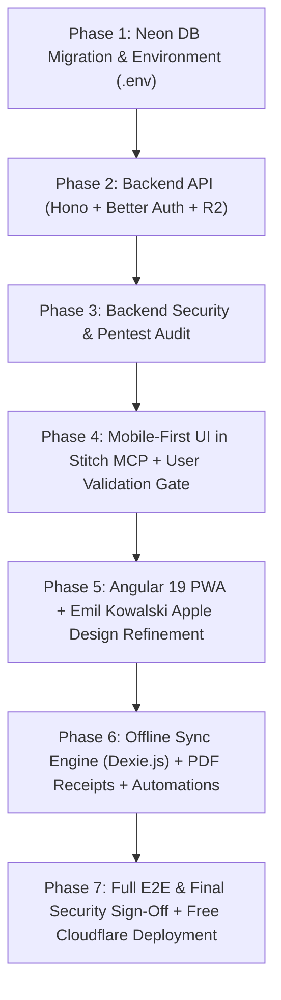

> **V1 scope revision — 8 November 2026:** The owner approved automated MTN/Orange Mobile Money payments and instructor/session operations. [docs/V1_SCOPE.md](docs/V1_SCOPE.md) is the current scope and overrides conflicting exclusions below. Revise implementation milestones and estimates accordingly; scope approval does not mean these features exist.

# Master Implementation Plan — Auto-École La Marseillaise (PWA)

> **Target Architecture:** 100% Free-Tier, Backend-First, Mobile-First Offline PWA
> **AI Engine:** Optimized for **Gemini 4 Argon** (phased execution, strict verification gates, automated tool/API provisioning, and security-first engineering)
> **Design System:** Google **Stitch MCP** (Mobile-First UI generation + User Validation Gate) refined with **Emil Kowalski's `apple-design`, `mobile-native`, and `emil-design-eng`** skills.

---

## 1. Executive Summary & 100% Free-Tier Tech Stack

To achieve **$0/month recurring infrastructure costs** while guaranteeing enterprise-grade security, offline reliability in Cameroon, and zero vendor pause limits, we use the following stack:

| Layer | Technology | Cost / Tier | Why This Tool |
| :--- | :--- | :--- | :--- |
| **Database** | **Neon Serverless PostgreSQL 16** | **$0/mo** (Free Tier) | Never pauses after 7 days of inactivity (unlike Supabase Free); scales to zero, wakes in ~500ms; supports Git-like DB branching (`main`, `dev`, `security-test`). |
| **Backend API** | **Hono (TypeScript) on Cloudflare Pages Functions / Workers** | **$0/mo** (100k req/day free) | Ultra-fast Edge API connected to Neon via `@neondatabase/serverless` over HTTP/WebSockets. |
| **Authentication** | **Better Auth** (Self-hosted in API + Neon) | **$0/mo** (Open Source) | Stores users, sessions, phone OTP codes, and roles (`admin`, `student`) directly inside Neon PostgreSQL. |
| **File Storage** | **Cloudflare R2** (S3-compatible) | **$0/mo** (10 GB free + **$0 egress**) | Zero bandwidth charges when students download heavy course PDFs or stream driving videos. |
| **Frontend PWA** | **Angular 19** (Standalone + Signals + `@angular/pwa`) | **$0/mo** (Open Source) | Built-in `ngsw-config.json` Service Worker, Reactive Forms for financial inputs, Signals for live offline/sync indicators. |
| **UI & Motion** | **Stitch MCP** + **Tailwind CSS** + **Emil Kowalski (`apple-design` + `mobile-native`)** | **$0/mo** | Mobile-first layouts generated in Stitch, refined with iOS-grade spring physics, translucent sheets, and mobile hardware fixes. |
| **Offline Engine** | **Dexie.js** (IndexedDB) + Background Sync Queue | **$0/mo** (Open Source) | Stores downloaded quizzes, course PDFs (Blob), balances, and offline mutations (`client_id` idempotency). |
| **PDF & Exports** | **pdfmake / jsPDF** + **SheetJS (`xlsx`)** | **$0/mo** (Client/Edge) | Generates numbered printable A4/POS receipts (`LM-YYYY-000001` or `LM-D1-0001` offline) and Excel student exports without paid APIs. |
| **Automations** | **Cloudflare Cron Triggers** + **n8n (Self-hosted Docker)** + **WhatsApp Cloud API / Deep Links** | **$0/mo** | Automated trial reminders (Day 7, 12, 14), overdue installment alerts, weekly admin digest, plus 1-tap WhatsApp receipt sharing. |
| **Security Suite** | **Semgrep OSS**, **OWASP ZAP**, **Nuclei**, + **Installed Security Skills** | **$0/mo** (Open Source) | Automated SAST, DAST, BOLA/IDOR, SQLi, JWT tampering, and offline clock-rollback penetration testing. |

---

## 2. Installed & Self-Provisioned Agent Skills & Tools

The following tools and skills have already been fetched or configured in the workspace environment:

1. **Emil Kowalski Design Suite (`github.com/emilkowalski/skills` — Installed):**
   - `apple-design`: Fluid iOS interfaces, pointer-down response, 1:1 direct manipulation, interruptible springs (`damping: 1.0`, `response: 0.35`), momentum projection, rubber-banding, translucent `backdrop-filter` chrome, optical typography tracking.
   - `mobile-native`: Eliminates web-on-phone tells (`100dvh`, `viewport-fit=cover`, `env(safe-area-inset-*)`, `-webkit-tap-highlight-color: transparent`, 16px minimum input font to prevent iOS auto-zoom, `@media (hover: hover) and (pointer: fine)` gating, `touch-action: manipulation`, `overscroll-behavior: none`).
   - `emil-design-eng`, `animate`, `animation-performance`, `choreograph`, `review-animations`.
2. **Security Auditing & Penetration Testing Suite (Installed + CLI):**
   - `addyosmani/agent-skills@security-and-hardening`
   - `better-auth/skills@better-auth-security-best-practices`
   - `getsentry/skills@security-review`
   - `usestrix/strix@api-security-testing`
   - Public Security Scanners: **OWASP ZAP (`zaproxy/zaproxy`)**, **ProjectDiscovery Nuclei (`projectdiscovery/nuclei`)**, and **Semgrep (`semgrep/semgrep`)**.
3. **Google Stitch MCP (`StitchMCP`):**
   - `create_project`, `generate_screen_from_text`, `create_design_system`, `edit_screens`, `get_screen`, `download_file`.
4. **CLI Auto-Provisioning (via User Account):**
   - `npx neonctl@latest` (authenticates via browser with your account to create the Neon project, branches, and fetch connection strings automatically).
   - `npx wrangler@latest` (authenticates via browser with your Cloudflare account to create the R2 bucket `la-marseillaise-resources` and deploy Pages/Workers).

---

## 3. Extensive Feature Specification (Complete Functional Catalog)

Every feature below is derived from `Cahier_des_charges_-_Application_Auto_École_La_Marseillaise.docx` and `la-marseillaise-schema.sql`, adapted for Neon PostgreSQL.

### 3.1 Access Rule & Core Business Invariants (Server-Enforced)
1. **The Golden Access Formula:**
   $$\text{HasAccess}(\text{student}) = (\text{now}() < \text{trial\_ends\_at}) \lor (\exists \text{ payment } p \text{ where } p.\text{cancelled\_at IS NULL})$$
2. **14-Day Free Trial (`trial_days = 14`):**
   - Starts immediately upon self-registration, OR at the exact moment a walk-in student activates their account via an admin invite code (`trg_students_trial`).
   - Non-extendable.
3. **Permanent Unlock on First Valid Payment:**
   - As soon as **1 valid payment** (`amount > 0`, `cancelled_at IS NULL`) is recorded for the student's enrollment, pedagogical access (courses + quizzes for their licence category) is unlocked **permanently**, even if a subsequent installment becomes overdue.
4. **Automatic Recalculation on Payment Cancellation:**
   - If a student's *only* payment is cancelled by the admin (`cancel_payment`) and their 14-day trial has expired, access is revoked immediately.
5. **Group Capacity Counting Rule:**
   - A seat in a group (`groups.capacity`) is only counted as occupied once the student has at least one valid non-cancelled payment (walk-ins/trials without payment do not block paying seats).
6. **Calculated-Only Financial States (Zero Manual Override):**
   - Total paid, remaining balance (`enrollment_balances` view), installment status (`paid`, `partial`, `upcoming`, `overdue` via `installment_status` view), remaining trial days, and student global status are **100% computed by SQL views/functions**, never typed manually.
   - Payments are automatically allocated to installments **in chronological order (`position ASC`, oldest first)**.
7. **6 Computed Student Statuses:**
   - `en_essai_gratuit` (In 14-day free trial, 0 payments)
   - `essai_termine_sans_paiement` (Trial expired, 0 payments — access locked)
   - `inscrit_a_jour` (Has paid $\ge 1$ installment, no overdue or upcoming-soon installment)
   - `tranche_bientot_due` (Next installment due within $\le 7$ days)
   - `tranche_en_retard` (At least one installment has `due_date < current_date` and cumulative paid < cumulative due)
   - `termine` (Enrollment status = `completed` and balance = `0 FCFA`)

### 3.2 Student Portal Features (`role = 'student'`)
1. **Self-Registration & Phone Verification (`+237`):**
   - Fields: Full Name, Cameroon Phone Number (validated in E.164 format `^\+237[26][0-9]{8}$`), Optional Email, Password, Licence Category (`Permis A`, `B`, `C`, `D`), and Open Group selection.
   - Phone verification via 6-digit OTP code.
   - Duplicate phone detection: If the school already created a walk-in record for that phone number, registration returns `PHONE_EXISTS` and prompts the student to enter their **Invite Code** instead.
2. **Walk-In Account Activation (Claim Invite Code):**
   - Dedicated flow (`/claim-invite` or magic link `?code=XXXX`) where a student created at the school desk enters their 8-character hex invite code, sets their password, links their login to their existing student & payment record, and starts their 14-day trial (if not already paid).
3. **Trial Countdown Banner:**
   - Persistent, non-intrusive top pill showing remaining trial days (e.g., *"Essai gratuit : 9 jours restants — Payez votre 1re tranche à l'auto-école pour débloquer l'accès illimité"*).
4. **Course Resources Library (Filtered by Student's Licence Category):**
   - Displays only published resources (`is_published = true`) matching `student.licence_category_id`.
   - Types supported: **PDF manuals**, **Video lessons** (streamed via R2 pre-signed URL or unlisted embed), **Revision sheets/Images**, and **External links**.
   - Shows exact file size in KB/MB (`file_size_kb`) before download.
   - **"Télécharger pour le mode hors ligne" button:** Stores the PDF/image/sheet binary inside IndexedDB (`Dexie.js`) with a checkmark badge (*"Disponible hors ligne"*), allowing full viewing with zero internet.
5. **Interactive Quiz & Timed Mock Exam Engine (Offline-Capable):**
   - Topic-based practice quizzes (`topic`) and official timed mock exams (`is_mock_exam = true`, `duration_minutes` countdown timer).
   - **Offline Quiz Packs:** Quizzes and their questions (`body`, `options` JSON array, `correct_index`, `explanation`) are cached locally in IndexedDB.
   - Instant post-quiz review showing score (`score / total`), percentage, pass/fail badge, and detailed explanations per question.
   - Progress tracker: historical score evolution chart and mastery per topic.
   - **Offline Score Sync:** Attempts taken without internet generate a UUID `client_id`, queue locally in IndexedDB, and sync automatically to `quiz_attempts` once back online (allowed by security policy even if the student's trial expired while offline!).
6. **Read-Only Payment & Installment Tracker:**
   - Visual progress bar of `Paid FCFA / Total Fee FCFA` and `Remaining Balance FCFA`.
   - Full installment schedule table (`1re tranche`, `2e tranche`, etc.) with due dates, amounts, and live status pills (`Payée`, `Partielle`, `À venir`, `En retard`).
   - List of all official payments with downloadable/printable numbered PDF receipts (`LM-2026-000001`).
   - Cancellation transparency: Cancelled payments remain visible (struck through) with the admin's cancellation timestamp and mandatory reason.
7. **Trial Expired Lock Screen (Paywall with Retained Profile Access):**
   - Shown when `now() > trial_ends_at` AND `student_has_paid = false`.
   - Blocks only `/resources` and `/quizzes`.
   - Clearly explains how to unlock access (visit Auto-école La Marseillaise to pay the 1st installment, shows exact amount of 1st tranche, school address, phone/WhatsApp contact button).
   - **Retained access:** The student can still view their Profile, Payment Schedule, Receipts, and School Contact info.
8. **Smart PWA Install Prompt:**
   - **Android / Desktop Chrome:** Custom bottom-sheet intercepting `beforeinstallprompt` with 1-tap native install.
   - **iOS Safari (iPhone/iPad):** Automatic detection of iOS non-standalone mode, displaying an Apple-styled step-by-step visual sheet (*"Appuyez sur Partager puis 'Sur l'écran d'accueil'"*).

### 3.3 Admin / Direction Portal Features (`role = 'admin'`)
Designed for extreme simplicity: large touch targets, clear French labels, minimal menus, zero accounting jargon.

1. **One-Time School & Catalogue Configuration:**
   - School Settings (`app_settings`): School name, trial duration (default 14 days), receipt prefix (default `LM`).
   - Licence Categories (`licence_categories`): Create/toggle `Permis A (moto)`, `Permis B (voiture)`, `Permis C (poids lourds)`, `Permis D (transport en commun)`.
   - Groups Management (`groups`): Name, licence category, start date, max capacity, total fee in FCFA (`bigint`), status (`open`, `closed`, `finished`).
   - Installment Plan Builder (`installments`): Add ordered tranches (`position`, `label`, `amount`, `due_date`). **Strict validation:** Sum of tranche amounts must equal `groups.total_fee` before saving.
2. **Ultra-Fast Payment Recording (< 10 Seconds):**
   - Instant search bar by **Student Name** or **Phone Number (`+237...`)**.
   - Auto-preselects the student's active enrollment, next unpaid installment tranche, and exact remaining tranche amount.
   - Payment method selector: **Espèces** (default), **MTN MoMo**, **Orange Money**, **Banque** + optional reference number.
   - Server-side balance guard: Cannot record an amount exceeding the student's remaining balance (`EXCEEDS_BALANCE`).
   - **Gap-Free Sequential Receipt Generation:** Automatically assigns `LM-YYYY-000001` online, or device-prefixed `LM-D1-0001` when recorded offline, generates a printable PDF receipt immediately, and triggers a WhatsApp/SMS confirmation.
3. **Payment Cancellation (Append-Only Immutable Ledger):**
   - Database trigger `trg_payments_guard` strictly forbids `DELETE` or modifying core fields (`amount`, `method`, `receipt_number`, `paid_at`) on `payments`.
   - Admin can only cancel a payment via `cancel_payment(payment_id, reason)` with a **mandatory text reason**.
   - Original row stays visible in the student's ledger; every insert and cancellation is permanently recorded in `audit_log` with actor UUID, timestamp, and full JSON snapshot.
4. **Quick Walk-In Student Creation & Invite Code Generator:**
   - 3-field rapid form: **Full Name**, **Phone Number**, **Group**.
   - Creates `students` record (`user_id = NULL`, `created_by_admin = true`) and `enrollments` record.
   - Calls `create_invite()` to generate a 1-time 8-character hex code (stored hashed with `SHA-256` in `invites`, valid for 7 days) + shareable activation link sent via WhatsApp/SMS.
5. **Direction Executive Dashboard (`admin_dashboard`):**
   - **4 Big KPI Cards:**
     1. Total Enrolled Students (`students_total` + breakdown of walk-ins without app account)
     2. Collected This Month in FCFA (`collected_this_month`)
     3. Total Still Owed in FCFA (`still_owed`)
     4. Students Overdue (`students_overdue`)
   - **"À Traiter" Action List:**
     - Students with overdue installments (with 1-tap WhatsApp reminder button).
     - Students whose 14-day trial ended without payment (`trial_ended_unpaid`).
   - **Simple Visual Charts:** Monthly collections bar chart & students per licence category.
6. **Student Directory, Detailed Student Dossier & Exports:**
   - Filterable list by Licence Category (`A/B/C/D`), Group, and Computed Payment Status.
   - **Fiche Élève (360° View):** Profile info, invite status, group & installment breakdown, full payment & receipt history, and quiz scores/attempts.
   - **1-Click Exports:** Export filtered student & payment lists to **Excel (`.xlsx`)** and **Printable PDF**.
7. **Pedagogical Content Manager (Resources & Quizzes CRUD):**
   - Upload PDFs/images directly to **Cloudflare R2** (`resources` bucket) with automatic `file_size_kb` calculation, or link external video URLs.
   - Create and publish Quizzes and Multiple-Choice Questions with explanations per licence category.

### 3.4 Offline-First Synchronization & Anti-Tampering Engine
1. **Global Sync Status Pill:**
   - Live top-bar indicator: 🟢 *Synchronisé*, 🟡 *Hors ligne — X action(s) en attente*, 🔄 *Synchronisation en cours...*
2. **Idempotent Offline Queue (`sync_queue` in IndexedDB):**
   - Queues `quiz_attempts` (students) and `record_payment` / walk-in creations (admin) with a client-generated UUID (`client_id`).
   - Retries automatically with exponential backoff when connectivity resumes (`window.addEventListener('online')`).
3. **Offline Access Verification & Clock-Rollback Protection:**
   - Server issues a signed access timestamp payload (`server_time`, `trial_ends_at`, `has_paid`, `max_offline_until`) stored in IndexedDB.
   - **Monotonic Clock Guard:** Every time the app runs, it stores `last_seen_timestamp = Math.max(last_seen_timestamp, Date.now())`. If `Date.now() < last_seen_timestamp - 5 minutes`, the app detects device clock tampering and locks offline content until the device reconnects to the server to verify the real time.
   - **Maximum Offline Lease:** Requires a server token refresh after a configurable offline window (e.g., 7 days for unpaid trial users).

---

## 4. Environment Configuration (`.env`, `.dev.vars`, `environment.ts`)

We will maintain strict separation between secret backend keys and public frontend configuration.

### 4.1 `.env.example` (Committed Template) & `.env` (Git-Ignored Local Secrets)
```dotenv
# ============================================================================
# AUTO-ÉCOLE LA MARSEILLAISE — ENVIRONMENT VARIABLES (.env)
# ============================================================================

# 1. NEON SERVERLESS POSTGRESQL
DATABASE_URL="postgresql://<user>:<password>@<endpoint>.neon.tech/la_marseillaise?sslmode=require"
DIRECT_DATABASE_URL="postgresql://<user>:<password>@<direct-endpoint>.neon.tech/la_marseillaise?sslmode=require"

# 2. BETTER AUTH / JWT SECURITY
BETTER_AUTH_SECRET="<64-char-cryptographic-random-hex>"
BETTER_AUTH_URL="http://localhost:8788"
JWT_OFFLINE_LEASE_SECRET="<64-char-cryptographic-random-hex-for-offline-clock-guard>"

# 3. CLOUDFLARE R2 OBJECT STORAGE (Course PDFs & Videos)
R2_ACCOUNT_ID="<cloudflare-account-id>"
R2_ACCESS_KEY_ID="<r2-access-key-id>"
R2_SECRET_ACCESS_KEY="<r2-secret-access-key>"
R2_BUCKET_NAME="la-marseillaise-resources"
R2_PUBLIC_OR_SIGNED_TTL_SECONDS="3600"

# 4. WHATSAPP BUSINESS CLOUD API & SMS FALLBACK (n8n / Notifications)
WHATSAPP_API_VERSION="v21.0"
WHATSAPP_PHONE_NUMBER_ID="<meta-phone-number-id>"
WHATSAPP_ACCESS_TOKEN="<meta-permanent-system-user-token>"
WHATSAPP_VERIFY_TOKEN="<webhook-verify-token>"
SCHOOL_OFFICIAL_WHATSAPP="+2376XXXXXXXX"
SMS_FALLBACK_PROVIDER="twilio_or_local"
SMS_API_KEY="<optional-sms-api-key>"

# 5. N8N AUTOMATION WEBHOOKS
N8N_WEBHOOK_URL="http://localhost:5678/webhook/la-marseillaise"
N8N_WEBHOOK_SECRET="<hmac-webhook-signing-secret>"

# 6. INITIAL SUPER-ADMIN BOOTSTRAP
INITIAL_ADMIN_PHONE="+2376XXXXXXXX"
INITIAL_ADMIN_EMAIL="direction@lamarseillaise.cm"
INITIAL_ADMIN_NAME="Direction La Marseillaise"

# 7. PUBLIC FRONTEND VARIABLES (Injected into Angular environment)
PUBLIC_API_BASE_URL="http://localhost:8788/api"
PUBLIC_APP_NAME="Auto-école La Marseillaise"
PUBLIC_DEFAULT_RECEIPT_PREFIX="LM"
PUBLIC_DEVICE_ID="D1"
```

---

## 5. Phased Execution Roadmap (Optimized for Gemini 4 Argon)

Following your instructions, we **build and security-test the Backend first**, then design the Mobile-First UI in **Stitch** (with your validation) refined with **Emil Kowalski's `apple-design` & `mobile-native` skills**, and finally build and connect the **Angular PWA**.



---

### Phase 1: Database Migration to Neon & `.env` Setup (Backend-First — Step 1)
**Goal:** Adapt `la-marseillaise-schema.sql` from Supabase to 100% native **Neon PostgreSQL 16**, provision the Neon database using your account, and set up `.env`.
1. **Provision Neon Database via CLI (`npx neonctl`):**
   - Authenticate with your Neon account (`npx neonctl auth`) and create project `auto-ecole-la-marseillaise` with branches `main` and `dev`.
2. **Create `la-marseillaise-neon-schema.sql`:**
   - Replace `auth.users` with native `public.users`, `public.sessions`, and `public.verifications` tables compatible with Better Auth.
   - Replace `auth.uid()` with a session context helper `public.current_user_id()` backed by `current_setting('app.current_user_id', true)::uuid` set per transaction by the backend middleware.
   - Preserve 100% of business triggers (`trg_students_trial`, `trg_payments_receipt`, `trg_payments_guard`, `trg_payments_audit`), views (`enrollment_balances`, `installment_status`), RPC functions (`register_student`, `create_invite`, `claim_invite`, `record_payment`, `cancel_payment`, `admin_dashboard`), and PostgreSQL RLS policies.
   - Replace `storage.buckets` with metadata columns pointing to **Cloudflare R2** object keys.
3. **Seed Starter & Realistic Test Data:**
   - Seed `Permis A`, `B`, `C`, `D`, sample groups, realistic installment plans in FCFA, sample road-code questions (Code de la route CEMAC/Cameroun), and initial Admin user.
4. **Create `.env` and `.env.example`:**
   - Populate connection strings and generated cryptographic secrets (`openssl rand -hex 32`).

---

### Phase 2: Backend API Construction (Hono + Better Auth + Cloudflare R2)
**Goal:** Build a rock-solid, zero-cost serverless API in `/backend` (Cloudflare Pages Functions / Workers with Hono) that exposes all business operations securely.
1. **Authentication & OTP Module (`/api/auth/*`):**
   - Phone (`+237...`) + Password login & sign-up.
   - 6-digit OTP verification endpoint (sends via WhatsApp Cloud API / console log in dev).
   - Walk-in Invite Code claim endpoint (`POST /api/auth/claim-invite`).
   - Signed **Offline Lease Token** endpoint (`GET /api/auth/offline-lease`) for the client-side clock-tampering guard.
2. **Student Endpoints (`/api/student/*`):**
   - `GET /api/student/me`: Profile, computed status, trial days left, enrollment & installment breakdown, payment history.
   - `GET /api/student/resources`: Returns published resources for the student's licence category **only if `student_has_access()` is true**, generating short-lived pre-signed Cloudflare R2 download URLs.
   - `GET /api/student/quizzes`: Returns full quiz + question packs for offline caching in IndexedDB.
   - `POST /api/student/quiz-attempts`: Idempotent batch sync endpoint accepting `client_id` UUIDs.
3. **Admin / Direction Endpoints (`/api/admin/*` — Strictly guarded by `is_admin()`):**
   - `GET /api/admin/dashboard`: Calls `admin_dashboard()` + returns the "À traiter" action list (overdue installments & expired unpaid trials).
   - `CRUD /api/admin/catalogue`: Licence categories, groups, and validated installment plans.
   - `GET & POST /api/admin/students`: Walk-in student quick creation + `POST /api/admin/invites` (returns 1-time 8-char invite code & WhatsApp deep link).
   - `POST /api/admin/payments`: Calls `record_payment()` with `client_id` idempotency and offline receipt number support.
   - `POST /api/admin/payments/:id/cancel`: Calls `cancel_payment(id, reason)` and logs to `audit_log`.
   - `CRUD /api/admin/content`: Upload PDFs/videos to R2 and manage quizzes/questions.
   - `GET /api/admin/audit-log`: Full immutable payment audit trail.

---

### Phase 3: Backend Security Testing & Vulnerability Audit
**Goal:** Rigorously attack and verify the backend and database using the best public security repositories and installed skills before writing a single line of frontend code.
1. **Static Application Security Testing (SAST):**
   - Run **Semgrep** rulesets (`p/security-audit`, `p/owasp-top-ten`, `p/typescript`, `p/sql-injection`) across `/backend`.
2. **Automated API Penetration Testing Suite (`/backend/tests/security/`):**
   - Guided by `usestrix/strix@api-security-testing`, `better-auth-security-best-practices`, and `addyosmani/agent-skills@security-and-hardening`:
     - **BOLA / IDOR Tests:** Verify Student A can *never* read Student B's payments, receipts, or enrollments.
     - **Privilege Escalation Tests:** Verify a student token calling `record_payment`, `cancel_payment`, `create_invite`, or `admin_dashboard` always receives `403 FORBIDDEN` at both API and PostgreSQL RLS layers.
     - **Paywall Bypass Tests:** Verify an unpaid student whose 14-day trial expired (`trial_ends_at < now()`) cannot fetch `/api/student/resources`, `/api/student/quizzes`, or R2 pre-signed URLs.
     - **Financial Integrity Tests:** Attempt to `DELETE` or `UPDATE` a payment amount in PostgreSQL (`payments_guard` must throw an exception); attempt to pay more than `balance` (`EXCEEDS_BALANCE`); replay the same `client_id` 10 times concurrently (must create exactly 1 payment and 1 gap-free receipt number).
     - **Invite Code Brute-Force & Replay Tests:** Verify expired or already-used invite codes fail atomically (`FOR UPDATE` row lock).
3. **Dynamic Scanning (DAST):**
   - Run **Nuclei / OWASP ZAP** baseline API scan against the local server and fix all findings.

---

### Phase 4: Mobile-First UI Design with Stitch MCP & User Validation Gate
**Goal:** Design all screens mobile-first using **Stitch MCP**, then pause for your explicit review and validation.
1. **Create Stitch Project (`create_project`):**
   - Title: `"Auto-École La Marseillaise — Mobile-First PWA"`.
2. **Generate Core Screens (`generate_screen_from_text` with `deviceType: "MOBILE"` and `"DESKTOP"`):**
   - **Screen 1 (Mobile):** Student Onboarding, Phone Registration (`+237`) & Invite Code Activation.
   - **Screen 2 (Mobile):** Student Home Dashboard (14-Day Trial Banner, Licence Progress, Quick Resume Quiz, Offline Status Pill).
   - **Screen 3 (Mobile):** Course Library & Offline Reader (PDF/Video cards with file size badges and *"Télécharger hors ligne"* states).
   - **Screen 4 (Mobile):** Interactive Quiz & Timed Mock Exam Screen + Instant Correction Sheet.
   - **Screen 5 (Mobile):** Student Payment Schedule & Receipt Viewer + Trial Expired Paywall Screen.
   - **Screen 6 (Mobile & Desktop):** Admin Executive Dashboard (4 Big KPI Cards, *"À traiter"* overdue list, 1-Tap *"Enregistrer un paiement"* action).
   - **Screen 7 (Mobile & Desktop):** Admin Ultra-Fast Payment Drawer & Printable Official Receipt Preview (`LM-2026-000001`).
   - **Screen 8 (Mobile & Desktop):** Admin Walk-In Student Creation, Invite Code Modal & Catalogue/Installment Configurator.
3. **🛑 MANDATORY USER VALIDATION GATE:**
   - Export and embed all Stitch screen previews in a walkthrough artifact for you to inspect.
   - Iterate with Stitch `edit_screens` / `generate_variants` until you explicitly approve the visual design.

---

### Phase 5: Angular 19 PWA & Emil Kowalski `apple-design` / `mobile-native` Refinement
**Goal:** Scaffold the Angular 19 PWA (`@angular/pwa`, Signals, Standalone Components, Tailwind CSS) and translate the validated Stitch designs into production code refined with Emil Kowalski's Apple design engineering rules.
1. **`mobile-native` Platform Baseline (Shipped in `index.html` & `styles.css` before first component):**
   - `<meta name="viewport" content="width=device-width, initial-scale=1, viewport-fit=cover, interactive-widget=resizes-content" />`
   - Dual `<meta name="theme-color">` for light and dark modes.
   - `100dvh` app shell layout with `env(safe-area-inset-top)` and `env(safe-area-inset-bottom)` padding for notched iPhones and Android gesture bars.
   - `-webkit-tap-highlight-color: transparent`, `overscroll-behavior: none` on `html, body`, `overscroll-behavior: contain` on scrollable sheets.
   - `font-size: 16px` minimum on all `input, select, textarea` + proper mobile keyboards (`inputmode="numeric"` for OTP/FCFA amounts, `type="tel"` for `+237` phones).
   - All `:hover` styles gated inside `@media (hover: hover) and (pointer: fine)`.
2. **`apple-design` & `emil-design-eng` Interaction Polish:**
   - **Instant Pointer-Down Response:** All buttons and cards respond on `:active` / `pointerdown` with `transform: scale(0.97)` over `120ms cubic-bezier(0.23, 1, 0.32, 1)` and `touch-action: manipulation`.
   - **Interruptible Spring Physics & Sheets:** Bottom sheets (Payment recording, Quiz explanation, iOS install guide) use critically damped springs (`damping: 1.0, response: 0.35`), 1:1 pointer capture drag tracking, velocity handoff, momentum projection (`decelerationRate = 0.998`), and rubber-band resistance at boundaries.
   - **Translucent Materials & Depth:** Sticky headers, bottom navigation bar, and floating sync pills use `backdrop-filter: blur(20px) saturate(180%)` with subtle specular top borders and scroll-edge gradient masks instead of harsh 1px dividers.
   - **Optical Typography:** System font stack (`system-ui, -apple-system, BlinkMacSystemFont`) with negative letter-spacing (`-0.02em`) on large KPI numbers in FCFA and tabular numerals (`font-variant-numeric: tabular-nums`) on all prices, countdowns, and receipt numbers.
   - **Accessibility:** Full support for `@media (prefers-reduced-motion: reduce)` and `@media (prefers-reduced-transparency: reduce)`.

---

### Phase 6: Offline Sync Engine (Dexie.js), Printable Receipts & Automations
**Goal:** Wire full offline capability, local PDF/Excel generation, and automated WhatsApp/SMS notifications.
1. **Dexie.js IndexedDB Schema (`LocalDbService`):**
   - Tables: `profile`, `resources_meta`, `resources_blobs`, `quizzes`, `questions`, `payments`, `installments`, `sync_queue`, `clock_guard`.
2. **Service Worker (`ngsw-config.json`) & Offline Sync Queue (`SyncQueueService`):**
   - Pre-caches Angular app shell, fonts, icons, and static assets.
   - Background sync flushes queued quiz attempts and offline admin payments (`client_id`) as soon as `navigator.onLine` turns true.
3. **PDF Receipt & Excel Export Service:**
   - Generates official A4 & 80mm thermal-ready PDF receipts (`LM-2026-000001`) with school logo, student details, payment method, tranche allocation, remaining balance, and QR/verification hash.
   - Admin 1-click `.xlsx` and `.pdf` student roster and accounting exports.
4. **Notifications & Automations (`/automations`):**
   - Scheduled Cloudflare Cron Worker + n8n workflow template (`n8n-workflows.json`) for:
     - Instant payment confirmation message (amount paid, receipt #, remaining balance, next due date).
     - Free trial reminders at **Day 7, Day 12, and Day 14**.
     - Installment due reminders (**D-3 before due date** and **D+1, D+7 after overdue**).
     - Walk-in student 1-time invite link dispatch.
     - Weekly Monday morning executive summary for the Direction.
   - Includes a **1-Tap WhatsApp Deep-Link Fallback (`wa.me/+237...`)** pre-filled with the formatted message so the admin can also send confirmations/reminders manually from their phone for $0 API cost!

---

### Phase 7: End-to-End Verification, Final Security Sign-Off & Free Deployment
**Goal:** Verify all 7 acceptance criteria from Section 14 of the Cahier des Charges and deploy to production.
1. **Playwright E2E Test Suite (Online + Simulated Offline Mode):**
   - Test 1: Student self-registers, verifies phone, accesses courses & quizzes during 14-day trial.
   - Test 2: Simulate trial expiry (`trial_ends_at` in past, 0 payments) $\rightarrow$ verify access is blocked; record 1st payment as admin $\rightarrow$ verify student access unlocks permanently.
   - Test 3: Admin records cash payment in $< 10\text{s}$ $\rightarrow$ verify gap-free receipt `LM-2026-000001` PDF is generated and student balance updates.
   - Test 4: Switch browser context to `offline: true` $\rightarrow$ open downloaded PDF course, take a quiz, record an offline payment $\rightarrow$ reconnect `offline: false` $\rightarrow$ verify automatic sync without duplicates.
   - Test 5: Verify dashboard KPIs match exact SQL sums (`collected_this_month`, `still_owed`, `students_overdue`).
   - Test 6: Cross-tenant security check ensuring Student A never sees Student B's data.
2. **Production Deployment (Cloudflare Pages + R2 + Neon):**
   - Deploy API + Angular PWA to Cloudflare Pages via `npx wrangler pages deploy`.

---

## 6. Questions to Clarify Before Starting Phase 1

Please review this plan and let me know:
1. **Neon & Cloudflare CLI Provisioning:** When we start Phase 1 & Phase 2, shall I launch `npx neonctl auth` and `npx wrangler login` so you can click "Authorize" in your browser and let me provision the Neon database and Cloudflare R2 bucket automatically on your account?
2. **WhatsApp Notifications Mode:** For V1, do you want both the automated **Meta WhatsApp Cloud API / n8n webhook integration** AND the **1-Tap WhatsApp (`wa.me`) zero-cost button** in the Admin interface so the school can send receipts/reminders even before Meta approves their business template?
3. **Language Scope:** Section 7 & 13 of the Cahier des Charges mention French as the primary language with English as an optional addition. Should V1 be **French-only** (for speed and simplicity) or **Bilingual FR/EN** from day one?
