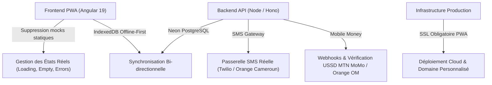

# Auto-école La Marseillaise — Feuille de Route de Production & Données Requises

Ce document récapitule les travaux techniques restants après retrait des données mockées ainsi que l'inventaire exhaustif des informations et ressources requises auprès de l'entreprise pour basculer en exploitation réelle.

---

## PARTIE 1 : Travaux Techniques Restants (Sans Données Mockées)

### 1. Remplacement des fallbacks statiques dans le frontend Angular 19
- **Empty States explicites** : Au lieu d'afficher des données fictives quand la base est vierge, afficher des écrans élégants :
  - *« Aucun paiement enregistré aujourd'hui — Caisse prête »*
  - *« Aucune vague de cours programmée »*
  - *« Votre historique de quiz est vide — Démarrez votre premier test »*
- **Skeleton Loaders** : Remplacer les clignotements par des placeholders visuels lors des chargements réseau.
- **Gestion fine des erreurs réseau** : Gestion des timeouts, réessais automatiques avec file d'attente hors-ligne (*SyncQueue*).

### 2. Raccordement direct et exclusif à la base Neon PostgreSQL
- Vérifier que chaque point d'API (`/api/student/*`, `/api/admin/*`, `/api/payments/*`, `/api/quiz/*`) opère sur les tables réelles de données :
  - `students`, `enrollments`, `installments`, `payments`, `courses`, `quizzes`, `audit_logs`.
- Intégrité référentielle et transactionnelle pour l'émission des reçus et le calcul du solde restant.

### 3. Passerelles réelles de communication et d'encaissement
- **SMS OTP** : Remplacer le code OTP en dur ou simulé par une vraie passerelle SMS locale (ex. API SMS Orange Cameroun, Twilio ou Camtel) pour authentifier les numéros camerounais (`+237`).
- **Paiements Mobile Money** : Validation automatisée des transactions MTN Mobile Money (`*126#`) et Orange Money (`#150#`) soit par API Marchand directe, soit par rapprochement de référence unique de quittance.

### 4. Déploiement & Environnement Production
- Configuration du nom de domaine avec certificat SSL / HTTPS (strictement requis pour l'installation PWA et le Service Worker sur Android/iOS).
- Variables d'environnement de production sécurisées (`DATABASE_URL`, `JWT_SECRET`, identifiants marchands).

---

## PARTIE 2 : Inventaire Exhaustif des Données & Ressources Requises de l'Entreprise

### 1. Identité Légale, Administrative & Graphique
| Élément | Description & Usage | Statut actuel dans le code |
| :--- | :--- | :--- |
| **Numéro d'Agrément MINTRANS** | Mention légale obligatoire sur toutes les quittances et attestations | `00412/MINT/DTT` (placeholder) |
| **Raison Sociale & Identifiant Fiscal** | RCCM, Numéro d'Identifiant Unique (NIU) pour conformité fiscale | À renseigner |
| **Adresses des Agences** | Adresses physiques réelles (ex. Bastos, Poste Centrale, Douala Akwa) | Yaoundé Bastos / Centre |
| **Logo Officiel HD / Vectoriel** | Fichier SVG ou PNG transparent haute résolution du sigle `AEM` et du porte-clés | SVG vectorisé temporaire |
| **Spécimen de signature & Cachet officiel** | Apposition automatique sur les reçus PDF officiels et livret de formation | Stamp SVG « DIRECTION CAISSE » |

### 2. Grille Tarifaire Officielle & Règles des Tranches
| Permis | Tarif Total (FCFA) | Tranche 1 (Inscription) | Tranche 2 (Conduite) | Tranche 3 (Examen) |
| :--- | :--- | :--- | :--- | :--- |
| **Permis B (Tourisme)** | *ex: 150 000 ou 95 000* | *À confirmer* | *À confirmer* | *À confirmer* |
| **Permis A (Moto)** | *ex: 75 000 ou 60 000* | *À confirmer* | *À confirmer* | *À confirmer* |
| **Permis C (Poids Lourd)**| *ex: 220 000* | *À confirmer* | *À confirmer* | *À confirmer* |
| **Permis D (Transport en commun)**| *ex: 250 000* | *À confirmer* | *À confirmer* | *À confirmer* |
| **Délai maximum de règlement** | Délais accordés entre chaque tranche avant blocage des heures pratiques | *14 jours d'essai gratuit* |

### 3. Organisation Pédagogique (Vagues & Contenus)
- **Sessions & Horaires** : Définition des vagues régulières (ex. Matin 08h-10h, Soir 18h-20h, Samedi intensif).
- **Parc de Véhicules & Moniteurs** :
  - Liste des moniteurs certifiés (Noms, spécialités, contacts WhatsApp).
  - Véhicules double commande affectés (modèles, immatriculations).
- **Syllabus & Quiz CEMAC Officiels** :
  - Fiches de cours et supports PDF au programme officiel du Ministère des Transports.
  - Séries officielles de questions d'examen blanc (Questions, 4 options, réponse exacte et explication réglementaire).

### 4. Coordonnées Financières & Comptes Marchands
- **MTN Mobile Money** : Code marchand officiel ou numéro de compte de réception des cotisations.
- **Orange Money** : Numéro marchand ou code partenaire officiel.
- **Banque partenaire** : Coordonnées du compte de dépôt pour les rapprochements (ex. BICEC, Afriland First Bank, SG Cameroun).
- **Numéro WhatsApp Caissière / Secrétariat** : Le numéro dédié pour les appels et le partage automatique des quittances WhatsApp.

### 5. Comptes du Personnel Initial
- **Gérance & Direction** : Accès administrateur complet et consultation des rapports mensuels.
- **Caissières / Secrétariat** : Profil de saisie des paiements, réactivation et impression de reçus (sans droit de suppression unilatérale).
- **Formateurs** : Consultation de la liste des inscrits de leur vague et pointage d'assiduité.
